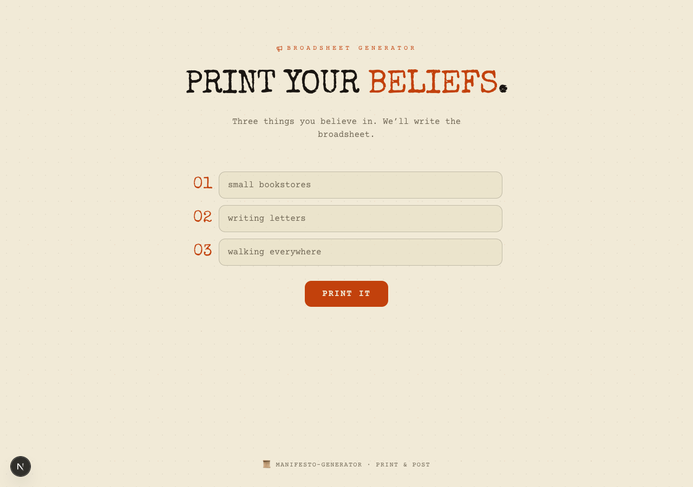

# 📜 Manifesto Generator

> Print your beliefs.

Type three things you believe in. AI writes you a five-bullet manifesto in the voice of a 1960s zine — punk earnestness, conviction without cringe. Downloadable as a typewritten broadsheet on warm paper.

## Stack

- Next.js 15 · App Router · TypeScript
- Tailwind CSS v4 (`@theme`)
- OpenAI `gpt-4o`
- `html-to-image`
- Framer Motion · lucide-react
- Special Elite · Plus Jakarta Sans · Courier Prime

## Setup

```bash
pnpm install
cp .env.example .env.local
# add your OPENAI_API_KEY
pnpm dev
```

Open http://localhost:3000.

## License

MIT


